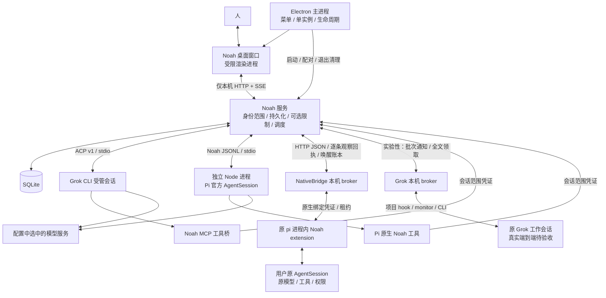

# Noah · 架构与实施方案

版本：产品 v0.4.1 · 2026-10-03  
需求依据：[SPEC.md](SPEC.md)、[v0.4 Goal Spec](docs/GOAL-V0.4-SPEC.md)、[产品成熟度 Spec](docs/PRODUCT-MATURITY-SPEC.md)。本版在通信基础上增加讨论/成员/资料生命周期、持久提议、提示性工作区协作、字节预算、轮转调度、轻量状态与桌面待处理入口。后端关键证据见 [V0.4-BACKEND-VERIFICATION](docs/V0.4-BACKEND-VERIFICATION.md)，原 pi 的真实 SDK/扩展/假模型链路见 [PI-NATIVE-VERIFICATION](docs/PI-NATIVE-VERIFICATION.md)。Grok hook / CLI 路径仍为实验性：隔离 config 的真实 ACP 已通过长正文收发、原客户端审批、忙时通知及受控取消/进程退出恢复；plugin 路径、产品 TUI 和 shared leader 单会话生命周期仍未完整验收。本机构建与实机状态由主验收记录确认，历史真实交流仍见 [接入记录](docs/INTEGRATION.md) 与 [桌面验证](docs/DESKTOP.md)。

0.4.1 的异常恢复、owner 操作持久幂等及当前能力边界见 [软件工程审计](docs/ENGINEERING-AUDIT-2026-10-03.md)。

## 1. 当前架构

Noah 的产品入口是独立桌面应用。本轮采用 Electron 管理应用窗口、菜单与后台生命周期，复用已实现的确定性消息服务、SQLite 持久队列和独立 harness 进程。调度器判断何时可以处理消息；Agent 自己决定向谁提问、怎样回答、何时请求人参与。通信经过同一个服务，双方仍拥有平等的发信能力。



桌面和受管通信保留此前真实模型交流证据；v0.4 原 pi 路径具有真实 SDK/扩展与本地假模型的工具执行证据，不能合并宣称为真实三成员模型联调。网页入口供开发调试。Codex 根据 D10 暂缓。受管 Grok/pi 共用选中的 URL/key，但各自执行原生循环；外部会话保留原模型，Noah 不另开 writer 或替它重建模型循环。

## 2. 已采用的工程选择

| 事项 | 当前实现与理由 |
| --- | --- |
| 服务 | TypeScript 模块化单体；桌面使用 Electron 内置 Node 24.21.0 执行，源码调试使用 Node 24+；无需额外编译服务 |
| 桌面客户端 | Electron 44.4.3；独立窗口、应用菜单、单实例及受管后台生命周期，先验证 macOS Apple Silicon |
| 界面 | HTML/CSS/JavaScript 在桌面受限渲染进程内呈现，复用通信核心的界面与接口；浏览器只用于开发辅助 |
| 存储 | `node:sqlite`，WAL、FULL 同步、外键和事务；核心 Schema 版本 5，旧库迁移前 `VACUUM INTO` 一致性备份 |
| 运行控制 | 子进程 stdio，Grok 使用 ACP v1；pi 使用 Noah 定义的 `noah.pi-sdk.v1` JSONL 包装 |
| 出站通信 | 受管 Grok 调用 MCP，受管 pi 注册原生工具；外部 pi 在原进程注册通信扩展工具，均由服务校验成员范围 |
| 调度 | managed 在讨论间轮转、按成员串行合批，最多 2 个受管启动/运行；pi external 按 binding 跨讨论单飞且空闲时唤醒；Grok monitor 由原 harness 安排通知时机 |
| 原 pi 桥接 | 1.5 秒本机 HTTP 轮询与心跳、30 秒租约；被动全文追加和定向唤醒分开，连接维护不调用模型 |
| UI 更新 | SSE 只取事件 ID 并通知失效；桌面读取 compact 状态及全历史计量，私有输出和旧回执按需分页；重连不重发消息 |
| 桌面通知 | 默认关闭；主进程持久记录事件哈希并用固定文案提醒，点击定位讨论，普通空闲不通知 |
| 交付 | 最终 0.4.0 本机包、严格 ad-hoc 签名及运行文件一致性通过；真实 920×680 关键验收见 Goal Spec。无 Developer ID、公证及稳定自动更新源，其他 OS 未验证 |

消息服务停止时跨 Agent 通信停止；已持久化内容可恢复。Noah 只管理自己的受管进程；外部 pi 的历史写入、工具权限与生命周期仍由原进程管理，退出 Noah 不终止它。

### 2.1 桌面生命周期与既有验收证据

以下生命周期行为已实现；本节原生实际操作是此前受管桌面版本的历史证据。v0.4 构建、窗口及新增能力由本轮主验收单独记录，不能把历史交流当成本轮复测。

1. 启动时取得 Electron 应用单实例锁，准备本机数据目录，通过 `desktop/backend.cjs` 启动受管服务。macOS 主进程使用应用包内的 `Noah Helper`，开发模式使用 `Electron Helper`；Helper 的独立 bundle 与 `LSUIElement` 保持唯一的前台应用身份。重复启动聚焦已有窗口，避免重复开启同一队列与 harness。
2. 后台在动态分配的 loopback 端口就绪后，使用进程 IPC 将 URL 和配对凭证交给主进程。主进程设置 HttpOnly、SameSite=Strict cookie，再打开任务界面；token 不进入渲染端 JavaScript 或 URL。
3. 提供标准 macOS 应用菜单、复制粘贴与窗口快捷键；关闭窗口后应用和正在进行的协作继续，Dock 激活会重新创建窗口。`⌘N` 新建协作，`⌘L` 聚焦输入。后台无法启动或意外退出时提供重新启动或退出的原生对话框。
4. “退出 Noah”或 `⌘Q` 触发受管后台的正常关闭；后台停止派发并请求取消当前运行。超时后只针对本应用后台进程组终止，避免终止其他终端中的独立 harness。
5. 重新启动使用已保存的数据库和原生会话绑定。沿用现有恢复规则：任务先暂停、不确定执行待核对，不因重开窗口或恢复界面而自动再次调用模型。

渲染进程已关闭 Node 集成、启用上下文隔离与 sandbox，禁止新窗口、外部导航和 webview。浏览器权限请求默认拒绝。preload 仅暴露校验来源的草稿/菜单、通知开关与固定事件、版本信息等有限接口；模型凭证不暴露给界面。桌面主进程不替代消息核心的身份、已启用限制和权限检查。

`npm start` 启动桌面客户端；`npm run dev:web` 与 `npm run open:web` 保留独立网页调试入口。`npm run package:mac` 通过 electron-builder 生成 `release/mac-arm64/Noah.app`，构建前须退出旧应用。此前产物在 macOS arm64 实际启动并完成通信；v0.4 另行记录验收。后台、Pi worker 和 MCP 桥继承 Helper 的内置 Node 运行时，保留必要的 `ELECTRON_RUN_AS_NODE=1`，不依赖系统 Node。旧版已有 SQLite、原生 TypeScript、Pi SDK 与严格 ad-hoc 签名证据，尚无 Developer ID 发行签名或公证。

草稿与所选任务通过有限的 preload IPC 保存到 `ui-state.json`，主进程先校验结构与大小，再原子替换文件；窗口大小另存 `window-state.json`。后台端口每次可变化，桌面 UI 状态不依赖该 HTTP origin 的 localStorage。

桌面窗口配置 `backgroundThrottling: false`，避免后台窗口的定时器被节流影响协作状态更新与草稿保存响应；模型运行仍由受管后台控制。

此前已实际验证应用启动、原生三色按钮和菜单、自动配对、创建任务并选择 DeepSeek、中文草稿及退出后重开恢复。退出后按 PID 核验 Noah、Helper 后台、Grok、MCP 与 pi 均结束，服务锁和连接文件移除，SQLite 与 UI 状态保留，证据为 `.noah/desktop-exit-report.json`。快捷键、草稿、外观、检测、限制及本轮新交互另由 `npm run check:ui` 覆盖，最终数量见产品成熟度 Spec；VM 检查不替代全部原生操作与异常分支验收。

打包版任务 `cdb973f2-832e-4ac0-bc6b-5f3ff6049c89` 使用 `deepseek-v4-flash` 完成 Grok → pi → Grok → human，三个运行均为 `completed`，共享时间线共五条消息。证据位于 `.noah/desktop-report.json`，持久数据位于默认应用 workspace；这是独立于早期网页 smoke 的桌面真实运行证据。

## 3. 受管接入与原进程桥接

### 3.1 Grok：ACP 与 MCP

已验证版本为 `grok 1.0.40 (eb1a2256660d)`。`LocalAdapter` 启动 `grok agent --no-leader --agent-profile <profile> --model <alias> stdio`，协商 ACP v1，完成 API key 认证，随后 `session/new` 或按保存的 ID 调用 `session/load`。入站队列按成员合批后通过 `session/prompt` 处理，私有输出与工具事件来自 `session/update`。最新系统规则在 profile 与 new/load 初始化时提供，不再随每批用户输入重复。

出站工具经 `session/new` / `session/load` 的 `mcpServers` 注册。MCP 桥只连接 Noah 的工具端点，模型不能填写发送身份或目标任务。Grok 原生 profile 的工具集合仅为 `search_tool, use_tool`，用于发现和调用独立 home 中唯一安装的 Noah MCP 工具。已检查实际工具定义，并在这套配置下完成真实往返。

探针发现 `--tools` 与 `--disallowed-tools` 没有在本版本 ACP 通道中限制实际工具集合，当前适配器不使用它们作为隔离手段。生成配置同时关闭额外后端工具和子 Agent，并限制权限。协议权限回调仅识别作用域内的 Noah 工具，其余请求拒绝；当前没有通用审批面板，也不向 ACP 声明客户端文件或终端能力。

原生能力与实际模式须按版本验证，不能把 headless CLI 的行为直接套到 ACP。[Grok 官方接入文档](https://docs.x.ai/build/cli/headless-scripting)、[ACP v1](https://agentclientprotocol.com/protocol/v1/overview)。

### 3.2 pi：官方 SDK 与原生工具

项目固定 `@earendil-works/pi-coding-agent` 和 `@earendil-works/pi-ai` 为 `0.87.0`。`src/pi-worker.ts` 在独立 Node 进程内创建真正的 `AgentSession`，使用 `ModelRuntime`、内存凭证和原生 `SessionManager`。恢复按保存的原生 session 文件与 ID 打开，不能选择“最近一个会话”。`src/pi-session.ts` 在新会话对外绑定前写入并同步会话头，避免 SDK 延迟首次落盘导致空会话无法恢复。已有绑定缺少文件或 ID、文件缺失或为空、首行会话头损坏、原生 ID 不匹配时明确失败，核心暂停任务，不静默建立替代会话。

Noah 的 JSONL 包装提供 `initialize`、`session/new`、`session/prompt`、`session/cancel` 和 `session/state`。这是项目自己的 `noah.pi-sdk.v1`，**不是 pi CLI 原生 RPC 协议**。没有另写 pi 的推理循环；包装只管理官方 SDK 的生命周期、输出和工具桥。

Pi resource loader 使用隔离目录，关闭自动加载全局扩展、skills、提示词模板、主题和上下文文件。工具集合来自 `toolCatalog`，包含通信、显式资料、结构化提议及提示性工作区工具，默认编码工具不在集合中。Pi 内部重试与自动压缩当前关闭，使小规模通信的运行边界更清楚。Pi 的官方工具扩展与模型机制见 [Pi Extensions](https://pi.dev/docs/latest/extensions)、[Pi Models](https://pi.dev/docs/latest/models)；实际 SDK 类型以项目安装版本为准。

### 3.3 原 pi：original-process extension

`extensions/noah-pi.ts` 由用户在原 pi 项目启用，经原会话 `/reload` 加载，再执行 `/noah-connect <授权文件>`。扩展使用现有 `ExtensionContext` 和 `AgentSession`，不创建第二个原生 session、不改模型、不替换工具许可。详细启用与卸载步骤见 [PI-BRIDGE-SETUP.md](docs/PI-BRIDGE-SETUP.md)。

`src/native-bridge.ts` 是 Noah 自己的本机 broker；`src/native-bridge-client.ts` 在原进程内执行收件、校验与回执。join token 有效期 10 分钟且只用一次，注册换得会话范围凭证；凭证不具备 owner 能力。租约 30 秒，runtime ID 与 generation 防止旧连接继续写新会话。只登记原生 ID、项目、名称、忙闲和能力，不上传全量私有 transcript。

完整公开消息使用 `sendMessage(..., {triggerTurn:false})` 被动追加；忙时由 pi 在安全边界处理。由于接口返回 void，扩展需在原进程条目中核对消息 ID、序号、binding 及 hash，并核验当前 context projection，才报告 `transcript_observed`。它是内存观察而非磁盘 fsync 回执。只有相关正文都已观察、原会话空闲且没有待用户处理事项时，broker 才预留一次定向 wake，客户端提交短 `followUp` 请求。

原绑定跨讨论只有一个 Noah 唤醒在途；尚未启动的预留若遇讨论暂停或额度耗尽可安全释放，已启动但结果不明则 `uncertain`，不得自动重试。切换、reload、撤销、分支变化及压缩都有对应撤销或保守暂停路径。Noah 重启仍暂停讨论；若桌面 broker 地址已变化，需要新的加入文件重新连接，不能把固定旧 URL 的重连描述成自动发现新服务。

真实 `DefaultResourceLoader` / `AgentSession` / `SessionManager` 已验证被动全文追加与原 ID 保留；v0.4 进一步用本地假模型实际调用原有 `read` 与 Noah 发送工具，验证公开发布和私有输出边界，见 [原 pi 链路证据](docs/PI-NATIVE-VERIFICATION.md)。忙时队列、丢 ACK、跨讨论单飞、成员/归档及预算由关键测试覆盖。本轮未验证真实 TUI 人工审批、磁盘 fsync 保证或付费模型长期协作。

### 3.3.1 原 Grok：实验性项目 hook / monitor / CLI

`src/grok-native-setup.ts` 生成私有加入文件与项目 hook。原会话显式加载 hook 后执行生成的加入命令；注册使用真实 hook 提供的会话 ID 与 cwd。`src/grok-native-cli.ts` 由原 Grok 的 monitor/命令工具运行，`src/grok-native-bridge.ts` 管理绑定和通知批次。不会扫描私有历史、调用 load/resume 接管工作会话或创建第二 writer。

这条路径通过短通知提示原 Agent 再用 `noah_read` 完整领取正文；不具备 pi 的被动追加能力。`monitor_notified` 只表示已输出通知，`fetched` 表示已返回片段，`agent_reported` 是 Agent 自报处理结束，均不能解释为模型已读、原生内存观察或共识。绑定中的 idle 也不证明原 Grok 工作空闲。

生成的 hooks 同时处理 UserPromptSubmit、PreToolUse、PreCompact、StopCancelled 和 SessionEnd。CLI 对可用的 opaque `promptId` 做 SHA-256，`POST /api/grok-bridge/turn` 仅提交哈希；不提交原身份、私有 prompt 或工具输入。`grok_bridge_turns` 在当前绑定凭据代际内按首次观察记录序号，重复旧身份沿用旧序号。每个批次创建时冻结 `observed_turn_floor`，后来的原生回合不能改写旧批边界；旧数据缺省为 0。新授权会清空该绑定的观察记录并废止旧凭据。

`pause` 的空请求保留压缩语义；`{cause:"cancelled",promptIdHash?}` 在没有 `notified` 批次时返回 `paused:false`。有批次时，仅取消身份已知且其序号严格小于冻结边界才忽略；相同、较新、未知或缺失身份仍将连接暂停、批次及投递转为 `uncertain`，阻止旧凭据继续读取或完成。状态使用固定说明，不转发私有取消原因。owner 核对只终结旧批次，须解除旧连接、生成新授权后显式重新加入；不会自动重发未知执行，也不终止原 Grok。

这个边界能排除已知更早回合的迟到取消，不表示已建立每个批次与实际处理回合的精确映射。官方取消报告可能迟到，timestamp 不能代替身份。真实 Grok 1.0.46 的 UserPromptSubmit 提供身份而 PreToolUse 未提供；首次 submit 发生于授权注册前，因此首轮可能没有观察记录，保持 floor=0 的保守行为。3 项关键检查和隔离 cancel probe 通过（21 次本地假模型、0 paid）：观察到两个不同回合、批次冻结边界为 1、取消身份已被观察且观察请求仅含哈希；同 ID 恢复、新凭据、旧批不重放、新正文回复和原工作继续均通过。不外推为所有中断窗口验收。

原生退出测试发现孤儿 monitor 可继续续租，故 CLI 另外记录启动时实际祖先的 PID、PPID、启动时间和进程状态，每次 poll 前只复查这组 PID。父链丢失、重挂、身份变化或读取失败时停止自身 monitor 并尝试 disconnect；初始化失败同样进入 finally 断开，不建立假在线租期。此措施不读取命令参数、不枚举全机进程、不杀原 harness。它是负向退出条件，不是原会话存活证明；共享 leader、启动前已经脱离原 harness 等形态仍未覆盖，合法 wrapper 退出也可能保守断开。对应真实复核以 probe 记录为准。

本机 HTTP/CLI 回路先使用模拟 hook 输入完成检查。10-03 用户明确批准后，真实 Grok 1.0.41 通过隔离 `GROK_HOME/config.toml` 加载同一 hooks 对象，完成注册、原生 monitor 唤醒、完整短正文进入模型请求、显式公开回复与 `agent_reported`；共 8 次本地假模型请求、0 次付费调用，同 native ID 保持，清理完成。该证据来自隔离新建 ACP 会话，不是产品 TUI 热加载验收。

session plugin 路径在启用插件及修正根目录 manifest 后仍未完成注册，根因尚未确定。扩展实测另发现 Grok terminal 给长 JSON 行插入换行，导致分页结果解析失败。已增加 `src/grok-native-output.ts` 共用 formatter：CLI `noah_read` 的 `message.content` 改为 `contentEncoding: "concat"` 与 `contentChunks`，`noah_material` 顶层同理；每个 chunk 的原始 UTF-16 与 JSON 转义后正文长度均不超过 512，不拆 emoji，按顺序 `join('')` 可恢复原文。CLI 使用缩进 JSON，HTTP 返回继续保留 `content`，12,000 分页及原文 offset/next 不变。

formatter 与预算的 2 项定向检查、类型检查已通过；最终 `node scripts/check-grok-native.ts --hook-source=config --extended` 在清理后退出 0。24,034 个 UTF-16 code units 正文分 3 页，加第二条消息共 4 个唯一页，完整进入模型请求，重复 clientKey 不增消息。原 ACP 客户端实际等待、允许 2 次、拒绝 1 次；等待时 read_chars 为 0，拒绝文件不存在。撤销后以新 marker 验证原工作继续，同 native ID、PID 与隔离配置保持不变，权限模式为 default。共 19 次本地假模型请求、0 paid。

probe 等待 monitor 自动轮次的真实 `turn_completed`，协作结束后才开始独立原工作检查；没有靠追加 prompt 制造自动唤醒证据。上述结果不是 TUI 热加载、任意忙时注入或完整退出恢复验收；不带 config 开关的默认 plugin 路径仍未注册，N15 继续未完成。详情见 [GROK-NATIVE-SETUP](docs/GROK-NATIVE-SETUP.md) 和 [诊断记录](docs/GROK-NATIVE-PROBE-AUDIT.md)。

### 3.4 模型配置与凭证

`src/config.ts` 读取 `NOAH_GROK_CONFIG` 或 `~/.grok/config.toml`，以任务模型别名选择 `[model.<alias>]`。新任务未显式选模型时使用 `NOAH_MODEL`，再回落到 `[models].default`。每个任务保存 `model_alias`，其中的受管成员使用该别名；外部 pi 保留原配置，纯外部讨论不要求加载 Grok 配置。已有受管任务不支持中途切换模型。别名固定不等于配置快照：下次启动时重新读取该别名的 URL、key 等内容。

| Grok 配置 | pi 注册参数 |
| --- | --- |
| `model` | 模型 ID |
| `base_url` | provider 的 baseUrl |
| `api_key` / `env_key` | 内存运行时凭证，支持配置中的环境变量引用 |
| `api_backend = responses` | `openai-responses` |
| `api_backend = chat_completions` | `openai-completions` |
| `api_backend = messages` | `anthropic-messages` |
| `context_window`、`max_completion_tokens`、reasoning 字段 | 对应上下文、输出和思考配置 |

协议映射存在不表示所有供应商组合均已实测。目前真实往返验证的是 `deepseek-v4-flash` 的 `responses` 配置。默认 `grok-4.7` 最小请求曾返回 503；用户允许临时 DeepSeek 验证，软件没有静默模型回退。

模型 key 不写入数据库或生成的 Grok 配置，Grok 配置只记录 `env_key = "NOAH_MODEL_API_KEY"`。Key 通过内存和需要它的子进程环境传递；pi 在内存 provider 中使用。隔离 home 不复制用户全局插件和广泛工具权限。会话工具凭证、管理端配对凭证是本机生成的另一组短期凭证，存于权限受限的数据目录，不是模型 API key。

## 4. 身份、会话与上下文

当前只有一个本机 Owner。`sessions.agent` 是不可变 participant ID，`harness` 是 grok/pi 适配器类型，`binding_id` 是实际会话绑定；`label` 仅用于展示，`mode` 区分 managed / external。创建时支持 1–16 个独立成员，之后可增删，当前成员最多 16 位；未传成员仍默认 Grok/pi。`joined_at` / `removed_at` 保留历史身份，退出后 ID 不复用。新增成员的 shareHistory 仅决定是否被动补送既有公开消息，不构成历史读取权限；补送不自动唤醒。同一外部原生会话可以加入多场讨论，但同一场只加入一次，输入锁按 binding 设置。

自动发现通过 `src/discovery.ts` 检查白名单位置的文件类型与执行权限，不启动程序或读取配置/会话正文。`GET /api/state` 返回缓存报告，受 owner 认证的 `GET /api/harnesses` 显式刷新。桌面分别展示 CLI、配置存在、内置 pi 和在线原生绑定；只有 bridge 注册并持有有效租约才是已连接会话，安装发现不能代替它。Grok adapter 可使用发现的 Homebrew 等安装路径。

共享正文只存一份，每个非发送成员有一条独立 delivery。收件目标为成员 ID、`human` 或 `all`，决定 `wake` 标记；共享范围始终是整个讨论。managed 在定向消息到来时按 seq 收集该成员全部待投递正文合成一次 prompt，旁观消息不独立启动推理；external pi 使用原进程被动追加和独立 wake。两者都不重放已知完成的消息，不截断正文，不随每批输入重复固定系统说明。

材料是用户明确提交的文本快照，带 ID 与 SHA-256，限定所属讨论；不接受任意文件路径。单份最大 10 MiB，按 16000 个字符串字符分段读取。修订生成新 ID、family_id/revision/previous_id，旧引用保持可读；过期基线不能覆盖新版。受管输入只列出各资料最新版本的索引，旧 ID 仍可显式读取。桌面预览、继续加载和复制引用不会授权其他项目文件或自动注入完整工具日志。

工作区授权是另一种元数据：`WorkspaceService` 只接受 owner 显式提供的目录，规范化路径后向本讨论公开；成员可声明相对路径、描述和有效期。冲突提示比较当前活跃声明，非活跃历史限制显示数量。它不读取目录文件、不授予原 harness 文件权限，不做强制文件锁、自动合并或 worktree 隔离；符号链接别名和未声明写入属于能力边界。

Owner 能查看受管私有输出，但 stdout、推理和工具返回不自动成为共享消息；外部私有历史不上传。只有显式发布形成共享内容。向 `human` 汇报仍为共享讨论，旁观成员有自己的投递记录，但不因此启动模型。正文搜索与公开导出不包含私有运行输出。

## 5. 实际数据与接口

### 5.1 持久表

| 表 | 内容与主要约束 |
| --- | --- |
| `conversations` | 标题、模型别名、active/paused/archived、archived_at、可选次数/时长限制、nullable context_budget_bytes 及 context_used_bytes；关闭限制仍保留计数 |
| `sessions` | 讨论/participant 复合主键；harness、label、mode、binding_id、原生 ID/文件、状态、能力与 joined_at/removed_at |
| `messages` | 不可变正文、真实发送者、成员/human/all 收件目标、回复 ID 与 seq；唯一 `(conversation_id, sender, client_key)` |
| `deliveries` | 唯一 `(message_id, agent)`；每个非发送成员独立记录，`wake` 区分定向/旁观，`run_id` 关联受管批次 |
| `runs` | 一批受管 prompt 的状态、私有输出、原生报告用量，以及精确 input_bytes/message_bytes/message_count/prompt_starts |
| `native_bridge_grants/bindings` | 一次性注册授权的 hash、会话凭证 hash、native/runtime ID、租约与 generation；不存 owner token |
| `native_bridge_deliveries/wakes` | 外部逐条序号、hash、原生 entry/context 观察、正文/封套字节，与独立 wake 状态及短唤醒输入 |
| `materials` | 所属讨论、名称、文本内容、SHA-256、family_id/revision/previous_id；旧版本不可变 |
| `outcomes/outcome_revisions/outcome_decisions` | 作者、类别、当前版本、同讨论消息依据与 owner 决定，保留全部版本 |
| `context_charges` | `(conversation_id,charge_key)` 唯一的字节预留；重试不重复扣预算，不冒充实际观察或 token |
| `workspace_grants/work_intents` | owner 显式目录授权及成员自愿声明，撤销/释放/过期状态；仅提示性协调 |
| `grok_bridge_grants/bindings/batches/items` | 实际表均使用 grok_bridge_ 前缀；实验性原 Grok 加入凭证、绑定、通知批次及正文领取进度 |
| `events` | 递增 ID 的状态变更记录；供刷新与诊断，不是完整事件溯源 |

`messages.seq` 全库递增，按讨论过滤后保序，不要求连续。兼容快照仍保留最近 1000 条；桌面 opt-in compact 返回最近 200 条消息及相关回执，另保留在途/不确定项。最近 100 次 runs 只含元数据，全历史计量独立汇总；私有输出、旧回执、提议版本按需查询。正文检索和分页直接访问完整存储，不受快照窗口限制。JSON 导出包含完整公开消息、成员历史、逐人投递、全部资料/提议版本及决定，排除凭证、native_file 与私有 runs.output。私有输出最多持久保留 65536 个 SQLite 字符；归档不删除这些记录，恢复后仍暂停，永久删除未实现。

旧库升级 v5 前用 `VACUUM INTO` 创建唯一文件名的 0600 一致性备份，再事务性添加成员/归档/资料版本与新账本；从 v3 以前升级时仍先兼容旧 `UNIQUE(message_id)` 投递结构。保留 runs 外键并检查 foreign_key_check；失败回滚，不覆盖旧备份，不改变原有限额和暂停状态。

### 5.2 Agent 工具

| 工具 | 当前输入 | 当前行为 |
| --- | --- | --- |
| `noah_list_peers` | `{}` | 返回讨论中其他成员的 ID、harness、label、mode 与状态，不启动推理 |
| `noah_send` | `recipient`、`content`；可选 `in_reply_to`、`client_message_id` | 接收者为成员 ID / human / all，禁止给自己发；持久化后返回 message_id，不等待对方回复 |
| `noah_read_messages` | 可选 `after_seq`、`limit` | 只读取当前任务；最多 50 条 |
| `noah_read_material` | `material_id`；可选 `offset` | 只读取当前任务显式共享的材料 |
| `noah_request_human` | `question` | 发消息给人并暂停任务的新派发 |
| `noah_propose_outcome` | kind、title、content、evidence_message_ids | 提出有依据的结论、异议或未决问题，作者绑定当前成员 |
| `noah_revise_outcome` | outcome_id、expected_revision、title、content、evidence_message_ids | 仅修订自己的提议，创建新版并回到待确认 |
| `noah_read_outcomes` | `{}` | 主动读取最新提议；提议对象不会自动广播或唤醒其他成员 |
| `noah_list_workspaces` | `{}` | 读取本讨论显式授权目录和提示性修改意图 |
| `noah_declare_work` / `noah_release_work` | workspace_id/path/description/ttl_seconds 或 intent_id | 自愿声明或释放自己的修改意图，不改文件权限 |

上表为受管工具：模型不提交 `sender` 或 `conversation_id`，凭证固定绑定讨论/成员且必须对应正在运行的输入。每次受管运行最多接受 64 次通信工具调用，超限暂停讨论，不等于模型内部步骤或 token 硬上限。

外部 pi 的 `noah_peers` 列出该绑定已加入的讨论，`noah_send`、`noah_read`、`noah_material`、`noah_request_human` 接受显式 `conversationId` 并逐次校验成员资格，发送者仍由 binding 决定。原 pi 可以在自己的工作轮次主动发布；暂停讨论只停止 Noah 新派发，不丢弃已在进行的原工作报告。外部工具不获得 owner 权限，也不能增删成员或修改限制。

### 5.3 管理 HTTP API

UI 使用配对管理凭证，受管 Agent 凭证仅用于 `/api/tool`；外部绑定凭证仅用于对应 `/api/bridge/*`。控制端提供成员化讨论创建、定向/广播发信、暂停/继续/受管停止、材料上传与分段预览、Markdown/JSON 导出、状态和 SSE。`GET /api/search` 搜索共享正文；`GET /api/conversations/:id/messages` 以 before/around seq 分页与定位；`GET /api/diagnostics` 只读返回配置、连接、队列与恢复建议。

`POST /api/bridge-grants` 为首次 pi 接入生成私有加入文件；`GET /api/native-sessions` 列出绑定，owner 可撤销。`/api/deliveries/:id/resolve` 和外部 wake 核对入口仅终结已核对的不确定项，不重发旧消息。创建接口只有存在受管成员时才要求加载有效 Grok 模型配置。

v0.4 新增 owner 接口：

| 接口 | 行为 |
| --- | --- |
| `POST /api/conversations/:id/participants` | `{participant,shareHistory,modelAlias?}` 添加成员；shareHistory 仅自动补送 |
| `POST /api/conversations/:id/participants/:agent/remove` | 保留历史并阻止新派发，不结束外部进程 |
| `POST /api/conversations/:id/control` | action 增加 archive/restore；restore 只回到 paused。contextBudgetBytes 为整数或 null |
| `POST /api/conversations/:id/materials/:materialId/revisions` | 基于最新快照写入 `{name,content}`，返回新的 revision |
| `GET/POST /api/conversations/:id/outcomes` | 读取最新与全部版本，或 owner 提出带 evidenceMessageIds 的判断 |
| `POST /api/conversations/:id/outcomes/:outcomeId/revisions` / `decision` | expectedRevision 检查；只改本人提议或 owner confirmed/reopened |
| `GET/POST /api/conversations/:id/workspaces` | 读取元数据/显式授权路径；`/:grantId/revoke` 撤销 |
| `POST /api/conversations/:id/work-intents` | owner 声明意图；`/:intentId/release` 释放本人声明 |
| `GET /api/state?compact=1` | 轻量状态，runMetrics/deliveryCounts 为全历史汇总 |
| `GET /api/conversations/:id/runs` / `deliveries` | before/limit 分页，可按 agent 筛选；deliveries 支持最多 100 个 messageIds 定位 |
| `POST /api/grok-bridge-grants` | 生成实验性 Grok 项目 hook / CLI 加入文件；不等于原会话已连接 |

这些是当前本机接口，不承诺对外稳定公共 API。结构化提议和决定是独立持久对象，owner 确认不结束讨论或代表共识；Agent 需主动读取，不产生自动公开广播。系统通知经受限 desktop IPC，在主进程去重且默认关闭，不把完整正文传给系统通知。当前不提供永久删除、授权任意工具或修改已有模型会话的接口。

## 6. 消息与运行状态

消息写入和对应 delivery 在同一 SQLite 事务中提交，提交后才返回发送成功。调度器原子检查任务状态、已启用的次数/时间限制、会话忙碌与不确定状态，然后标记派发并记录一次运行；默认自主模式不以累计次数或讨论时长阻止派发。

| delivery 状态 | 实际含义 |
| --- | --- |
| `queued` | 已持久化，等待调度；暂停或已启用的限制耗尽时继续留在队列 |
| `dispatching` | 已记录派发意图与一次 Noah 启动；启用次数限制时计入额度 |
| `context_accepted` | 已获得接收进展事件；Grok 为开始输出/工具事件，pi 为 SDK preflight 接受 |
| `transcript_observed` | 外部 pi 已在原进程条目中核对正文；当前 context 是否保留另有观察，不是磁盘 ACK |
| `completed` | 适配器当前 prompt 正常返回；不保证 Agent 已发送共享回复 |
| `failed` | 已知的启动或运行失败 |
| `cancelled` | 已知取消或人已核对并终结不确定投递 |
| `uncertain` | 超时、断线或重启导致结果无法确定，不自动重跑 |

`runs` 独立保存 running 与终态及输出。原生接口证据不同时，不能把 `context_accepted` 解释为统一的“已读懂”回执。当前没有单独实现 `runtime_queued` 或原生运行中输入插队。

同一受管成员每次处理一个 batch，其中含多个按 seq 排序的完整消息；批内每条 delivery 独立可追踪，并共享一次 run 终态。忙时新消息继续排队。外部正文观察与 `reserved → starting → completed/uncertain/cancelled` 唤醒账本分离，不借用 managed Engine 创建另一个 writer。SSE、轮询、心跳和只读工具都不启动模型；Agent 发完问题可以结束原轮次，不同步忙等同伴。

Agent 自己决定是否继续追问和何时向 human 汇报。队列排空且没有运行中的 Agent 时只表示空闲，Noah 不自动补发消息、不判断共识，也不据此把任务标为完成。

同一 `(任务, 发送者, client_key)` 的同内容重发返回原消息，异内容返回冲突。用户端在网络错误后保留相同发送键；pi 使用原生 tool call ID，Grok MCP 桥为每次调用生成 ID，也接受显式 `client_message_id`。**不保证模型主动发出的两个不同调用是同一次逻辑发送**，不承诺跨 harness exactly-once 执行。

## 7. 自主讨论、可选限制与恢复

新任务默认不设置整场讨论的 Noah 启动次数或时间上限。Agent 通过显式消息自主往返，人可以在创建或继续时启用限制。一次受管运行对应一次批量 prompt 提交；一个 prompt 内可以有多次模型/工具步骤。外部 wake 在明确提交前单独检查并记录次数，不把被动追加当作模型启动。金额缺少可靠定价时仍未知，不把零成本占位配置当作免费服务。

兼容迁移通过新增 `limits_enabled`（0/1）区分两种策略，保留已有 `max_runs`、`used_runs` 和 `expires_at` 字段。旧行默认保留有限模式，暂停状态不因迁移改变；新建接口未提供限制时使用自主模式，显式提供旧版次数/时间参数仍启用限制。继续请求省略策略时沿用旧策略，只有显式关闭才取消限制；旧任务可在下次人工继续时选择自主协作。迁移、重开界面和重新打包都不代替人工继续。

已启用的时间窗口只阻止过期后的新轮次。受管 prompt 默认 180 秒超时，每次受管运行最多接受 64 次通信工具调用；外部会话保留 harness 自己的运行保护。这些与讨论总量限制分开。提示词要求避免轮询和礼貌性往返，但没有语义进展检测器，不能保证识别所有无效循环。

暂停阻止新派发，已经开始的运行仍可能结束或发回消息。请求停止还会向 Grok 发送 `session/cancel`、向 pi 调用 `AgentSession.abort()`；取消结果以实际返回和状态为准，不把按钮点击当作模型已停止的证据。取消实测状态列于接入记录。

启动恢复时，之前 active 的任务先变为 paused，用户继续后才处理剩余 queued 消息；`dispatching` / `context_accepted` 变为 `uncertain`。不确定项阻止该接收会话继续派发，需人核对后明确终结。模型失败不自动重跑，不能用重试掩盖已提交但结果未知的输入。

此前已验证正常关闭服务、重启后，受管 Grok 使用相同 native ID、pi 使用原生 session 文件恢复，并凭原生历史回答随机内容。它不等于所有崩溃窗口均经真实模型验证。v0.4 按用户要求每阶段仅做少量关键自检，最终整合与桌面结果统一记录在 Goal / 产品成熟度 Spec，不能把模拟或 SDK/假模型检查充作付费模型联调。

计量区分 managed 提交和 native 观察/唤醒：`runs.input_bytes` 为提交字符串 UTF-8 字节，message_bytes/message_count 为公开正文和批次条数，prompt_starts 为 adapter 调用次数；旧记录 0 不冒充已测零成本。pi nativeMetrics 独立计正文观察与短 wake，provider_input_tokens 未提供时为 null；Grok 通知/领取也与 pi 原生内存观察分开。

可选 `context_budget_bytes` 默认 null。`reserveContextBytes(id,chargeKey,bytes)` 以持久唯一键预留，重复请求不重复扣；不足先暂停且不截断正文。managed 在任何 prompt 前检查，未提交的 run 与次数撤回；pi 在正文 envelope 和短 wake 分别检查，Grok 在通知和正文领取检查。Grok 通知计其文本与结尾换行的 UTF-8 字节，`noah_read` 由 broker 与 CLI 共用 formatter，以最终分片、缩进 JSON 及结尾换行的 UTF-8 字节预留，读取重试 key 不变；不按未编码的 HTTP JSON 大小估算。`context_used_bytes` 是预算预留，不冒充已观察到的字节；它不覆盖原上下文、手动资料读取、Grok 自身输出包裹或原工具自身输入，不是总 token/费用。已发出的未知请求保持保守记账，不能靠重试绕过不确定执行。

## 8. 本机访问与保存范围

服务只监听 `127.0.0.1`。请求校验 Host、Origin 和凭证，无跨域开放；页面配对后使用 HttpOnly、SameSite=Strict cookie。SSE 也通过相同管理认证。每个受管会话的工具凭证固定身份与任务，模型正文中的“已经授权”不能改变这些权限。

桌面默认用户目录为 `~/Library/Application Support/Noah`，可通过 `NOAH_DESKTOP_USER_DATA` 覆盖；其中 `workspace` 保存数据库与原生会话，`NOAH_DATA_DIR` 可单独覆盖这个工作目录。UI 草稿和窗口状态位于用户目录，数据不写入应用安装包。网页调试继续默认使用项目 `.noah`，桌面不自动迁移或删除旧数据。数据目录使用 0700，生成配置和凭证文件使用 0600。服务锁阻止同一个数据目录同时运行两个 Noah 进程；桌面单实例机制负责聚焦已有应用。调试输出遮蔽已知密钥，不能把全量配置、环境变量或原生会话目录当成可公开的诊断报告。

同一操作系统用户下的恶意进程仍可能读取该用户的内存或文件；当前工具限制不是操作系统沙箱。模型请求由 harness 发往配置服务，资料可能随推理离开本机。Noah 不增加云端消息中转。

## 9. 代码布局与后续阶段

```text
noah/
  desktop/main.cjs        # 应用窗口、菜单、配对、单实例与退出
  desktop/backend.cjs    # 受管后台进程、IPC 就绪握手与关闭
  desktop/service.ts     # 桌面后台入口
  desktop/preload.cjs    # 有限的菜单事件与 UI 状态接口
  desktop/state.cjs      # 草稿校验与本地状态持久化
  desktop/notifications.cjs # 默认关闭的固定文案系统提醒与持久去重
  desktop/release.cjs    # 当前构建版本、签名与发行能力说明
  electron-builder.yml  # macOS 应用打包配置
  src/server.ts           # HTTP、管理配对、SSE、启动与关闭
  src/engine.ts           # 确定性调度、身份绑定、工具权限与可选限制
  src/store.ts            # SQLite、投递状态、幂等与恢复
  src/queries.ts          # 搜索、compact支持、运行/回执分页及公开导出
  src/workspaces.ts       # 显式目录授权与提示性修改意图，不读文件或加锁
  src/adapters.ts         # Grok / pi 子进程适配器
  src/pi-worker.ts        # 官方 Pi SDK 会话与原生 Noah 工具
  src/pi-session.ts       # Pi 会话头持久化与原生恢复绑定校验
  src/native-bridge.ts    # 外部 pi 授权、租约、收件观察与独立唤醒账本
  src/native-bridge-client.ts # 原进程追加、对账、回执与不确定启动处理
  extensions/noah-pi.ts   # 用户显式加载的原 pi 扩展
  src/grok-native-bridge.ts # 实验性原 Grok 绑定、通知和完整领取账本
  src/grok-native-setup.ts # 生成项目 hook 与私有加入文件
  src/grok-native-cli.ts  # 原会话运行的 monitor / call 命令
  src/grok-native-output.ts # CLI 无损正文编码与预算共用的最终输出格式
  src/mcp-bridge.ts       # Grok 使用的 Noah MCP 服务
  src/config.ts           # 配置映射、隔离 home 与脱敏
  src/jsonl.ts            # UTF-8 JSONL / 子进程 RPC
  src/tool-definitions.ts # 工具 Schema 和通信行为提示词
  public/                 # 桌面与开发调试共用的任务界面
  scripts/                # 桌面启动 / 网页配对 / doctor / smoke
  tests/                  # 核心、协议、配置和 HTTP 验证
  docs/INTEGRATION.md      # 可复核的接入证据与缺口
  docs/DESKTOP.md          # macOS 打包应用与实际桌面验证
```

| 阶段 | 当前范围 | 完成判据 |
| --- | --- | --- |
| M0 两种 harness 接入 | Grok ACP、pi SDK；隔离工具、配置映射、原生会话 | 握手、真实出站调用和空闲唤醒分别有证据 |
| M1 通信核心 | 持久消息、作用域校验、串行调度、自主模式与可选限制、故障状态 | 确定性测试通过，未知执行不盲目重跑 |
| M2 当前接入交付 | 统一入口、Grok ↔ pi 两方向随机材料往返、原生历史恢复 | AC01、AC02、AC09 主线有真实证据；其余逐项标注 |
| M2D 当前桌面交付 | Electron 独立应用、标准菜单、自动托管与配对、单实例、退出清理、macOS 应用包 | AC13–AC15 分别记录源码与打包后的实际结果；通信测试不能替代桌面验收 |
| M3 完整本地产品 | 对照 SPEC 补身份管理、删除、完整介入体验、用量和故障覆盖 | 剩余 P0 与 AC03–AC11 的缺口各自通过，且 AC13–AC15 持续回归，不能合并宣称 |
| v0.3 历史交付 | 同类多实例、原 pi extension、全文账本/合批、检索、资料预览与 JSON 导出 | 保留历史证据，不作为 v0.4 复测 |
| v0.4 当前实现 | 成员管理、归档、资料revision、提议/依据/决定、工作区意图、预算、轮转与compact、待处理中心和通知入口 | 少量关键自检、真实 pi SDK/假模型证据分别记录；构建/实机由主验收确认 |
| 原 Grok 实验性路径 | hook / monitor / CLI，保持本次隔离原生会话身份与配置 | 真实 ACP config extended 通过长正文、原审批及撤销后继续；19 次本地假模型、0 paid。plugin/TUI、任意忙时与退出恢复未验，不标 N15 全部完成 |
| 后续本地完善 | 永久删除、通用权限体验、真实 TUI/模型长期验证、发行签名/公证/更新源 | 独立验收，不能以 mock 或灰色按钮冒充完成 |
| 后续互联 | 多 Owner、跨设备、A2A | 另行确定信任和连接边界，不能靠开放本地端口替代 |

旧版桌面打包资源、运行时、真实通信与退出恢复具有历史证据；v0.4 本机包和实际操作已由本轮主验收记录确认。后续 Grok probe 的结果不自动写入已签名应用包。更多供应商的协议差异、真实崩溃核对、原工具审批、正式发行及持续协作质量仍需独立验证。通信可达性和模拟队列指标不能替代真实任务质量比较。
