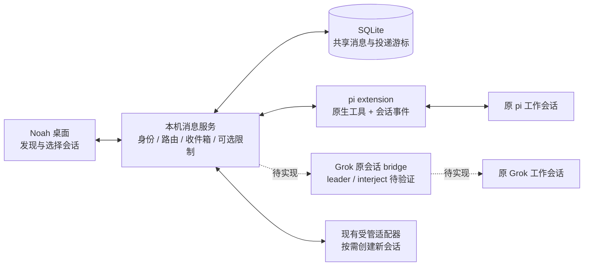

# Noah：连接原工作会话的通信方案

2026-10-02 · 产品 v0.3 实现对照，延续 SPEC 0.5 的产品决策。

**核心体验：打开 Noah → 自动发现本机 harness → 新建讨论 → 混选已有会话与新会话 → 原工作继续，其他 Agent 随时参与。**

本版已实现受管 Grok/pi 多成员、原 pi 进程内 extension、全文逐成员账本与定向合批。原 pi 已完成真实 SDK 零模型验证，本轮未进行付费模型端到端讨论；Grok 原工作会话桥接仍未实现。目标与完成证据须分开阅读：详细差距和逐项实践见 [产品成熟度 Spec](PRODUCT-MATURITY-SPEC.md)，参考机制及证据见 [竞品研究](COMPETITIVE-RESEARCH.md)，具体交付边界见第 8 节。

## 1. 已确认的产品行为

- 独立桌面应用负责发现、发起、观察和管理讨论；用户可以继续在原 harness 中工作。
- 讨论成员是**会话实例**，不是固定的模型或 harness 名称。可以选两个不同 harness，也可以选同一 harness 的两个不同会话。
- 每个成员可选“连接已有会话”或“新建会话”，同一讨论允许混用。
- Agent 平等收发；类似子代理交代进展的部分是异步报告机制，不是固定父子权限关系。
- 用户选择了**原会话接收完整讨论过程**。不能默认替换成“另开讨论，最后只回传摘要”。
- 完整讨论指所有显式发布的共享发言、问题、回答与结论。不包含参与者的私有思考、原聊天全文、shell 输出或工具日志。
- 共享资料仍需明确授权；新讨论默认由 Agent 自主往返，不设总运行次数或时间上限，用户可以主动启用限制。重要决定交给人。Grok/pi 仍是此前已确认的第一接入组合，Codex 暂缓。
- Agent 决定是否追问、回复和汇报结论；队列排空且没有在途运行只表示空闲，不证明全员共识或任务完成。单次运行异常保护与讨论总量限制分开。

## 2. 使用流程与状态

### 第一次打开

自动探测 PATH 和有界的常见安装目录；GUI 启动时不能假定继承用户的 shell PATH。分别显示 CLI、配置存在性和内置运行时。不会在发现阶段启动模型、执行发现的二进制、导入 harness SDK、读取密钥或全量私有会话。

| 界面状态 | 证据 | 可执行操作 |
| --- | --- | --- |
| 已检测到 CLI | 已知位置有可执行文件 | 检查版本或建立对应连接；不能直接宣称健康 |
| 仅发现配置 | 已知配置文件存在 | 显示缺失运行环境；存在不代表凭证有效 |
| Noah 内置 | 随应用提供的 pi SDK | 用配置创建独立 pi 会话；不能冒充外部 pi CLI |
| 已连接会话 | 活跃桥接器注册并持有有效租约 | 加入讨论、查看忙闲和接收能力 |
| 可恢复历史（后续目录能力） | 明确原生会话元数据 | 当前不提供通用历史选择器；以后恢复或分叉也不得标为实时连接 |
| 需要首次启用 | 未加载桥接或当前模式不支持 | 显示具体启用方式和影响，不伪造一键连接 |

“即开即用”意味着尽量复用已有安装和配置、自动处理 Noah 后台与连接；它不能消除原 harness 根本不提供的接入能力。需要一次 extension 加载的工具必须解释清楚，不能靠另开进程写同一个历史文件制造假连接。

### 新建讨论

1. 选择原工作会话，显示 harness、项目、标题、最近连接时间和忙闲。标题不能靠扫描所有私有正文生成。
2. 添加其他成员：选已有连接，或从支持创建的 harness 新建。每一行独立选择，不能锁定为一个 Grok 加一个 pi。
3. 已有会话沿用原模型与工具权限；Noah 新建的 pi 暂按已确认策略使用 Grok 配置。当前演示会话限制为通信工具，不代表所有新建工作会话永久没有编码工具。
4. 设置共享资料，按需启用次数与时间限制；默认自主讨论。原会话默认接收完整共享讨论，明确说明它会增加上下文。
5. 发出第一个问题。发送返回消息 ID，发起者可继续工作；回复通过桥接器进入原会话。
6. 暂停讨论只阻止 Noah 新派发；结束/退出不能杀掉用户独立启动的原会话。

v0.3 每场创建支持 1–16 位成员，可包含同类多个实例；已有原会话目前只支持已授权 pi bridge。成员数是创建容量，不是讨论总运行次数。创建后动态增删成员仍未实现。受管成员当前共用讨论选择的模型别名，外部原 pi 沿用自己的模型；纯外部讨论不依赖 Grok 配置。

## 3. 使用什么技术



### 本机消息服务

保留已有 TypeScript/Node.js 服务与 SQLite WAL。业务上是持久收件箱和发布/订阅：一次写入共享消息，每位成员拥有自己的投递状态与游标。Agent 调用工具发布消息，服务确定发给谁、何时可处理；不设调度 LLM，不靠模型轮询。

控制、工具和当前 pi bridge 使用本机 HTTP JSON。桌面 SSE 只通知状态变化；原 pi 扩展每 1.5 秒轮询收件箱并心跳，租约为 30 秒。这些本机维护请求不调用模型。可靠性来自 SQLite、独立投递序号、会话绑定、原进程内容校验和显式观察回执，不来自传输方式本身。当前不需要 Redis、云端消息服务器或完整 A2A；不能把 1.5 秒轮询写成已达到 500 ms 投递目标。

### MCP、ACP 和 pi extension 分别做什么

| 技术 | 在 Noah 中的职责 | 不能由它推导的能力 |
| --- | --- | --- |
| MCP tools | 给支持 MCP 的 Grok 暴露 `noah_send/read/...` 出站工具 | 接入 MCP 不表示 Noah 可以随时让原会话自动开始推理 |
| ACP | 创建/恢复 Noah 受管会话、提交 prompt、接收更新与取消 | `session/load` 不普遍等于对正在运行的 TUI 无副作用 attach |
| pi extension API | 在原进程中注册工具、报告会话、接收消息、在安全点进入上下文 | 不能无条件 attach 一个此前未加载扩展的任意进程 |
| HTTP/SSE + SQLite | 本机不同进程之间的运输、持久消息、成员路由与恢复 | 数据库已保存不等于模型已处理或认可内容 |

当前三条路径分别是 Grok ACP + MCP、pi 独立 AgentSession + 原生工具，以及原 pi 进程内 extension + 本机 broker。前两条创建 Noah 受管环境，第三条保留用户原工作环境；没有用恢复同一 JSONL 文件来模拟实时连接。

CC Switch 的会话管理设计可参考安装/路径探测、会话列表和恢复入口；其 [Session Manager 文档](https://github.com/farion1231/cc-switch/blob/main/session-manager.md) 以记录管理和终端恢复为目标，不能用它证明跨 Agent 实时投递已经解决。[ACP 会话接口](https://agentclientprotocol.com/protocol/v1/session-setup) 也需要按具体实现协商能力。

## 4. 身份与协议契约

以下记录 v0.3 实际字段与仍待扩展的边界。受管 `/api/tool` 保持原工具名；外部 `/api/bridge/tool` 使用独立 credential，可按已加入的 `conversationId` 选择讨论。

### 三种不同 ID

- `harness`：grok、pi 等适配器类型。
- `binding_id`：实际工作会话绑定；受管成员有独立目录，外部 binding 另存 native/runtime ID、generation 与租约。
- `agent`：兼容旧字段名，v0.3 的含义是讨论 participant ID。不能用 `grok` 代替所有 Grok 会话；旧讨论的 `grok/pi` 成员 ID 保持不变。

同一会话可参加多个讨论，但输入调度锁按 `session_binding_id` 设置，不能按 `(讨论, harness)` 分别加锁。外部 session 由原进程写入；Noah 不为它另开一个写入相同历史的 SDK/CLI。

### Bridge 注册

桥接器主动报告白名单元数据：原生 session ID、可选标题/项目、harness 与版本、busy/idle/waiting_user 状态、支持的接收模式。不得上传 auth store、API key 或完整环境。

首次启用由 owner 生成 0600 的加入文件，其中是本机地址和有效期 10 分钟、只能使用一次的 join token。原 pi 执行 `/noah-connect` 后交换会话范围 credential 和租约；owner token 不交给 Agent。凭证来自实际绑定而非模型参数。会话切换、reload、退出、租约失效和重连都使旧 generation 失效；迟到响应不能写入新会话。项目级启用与卸载见 [PI-BRIDGE-SETUP.md](PI-BRIDGE-SETUP.md)。

### 共享消息

```json
{
  "id": "message-uuid",
  "conversation_id": "discussion-uuid",
  "seq": 42,
  "sender": "participant-a",
  "recipient": "participant-b",
  "in_reply_to": "earlier-message-uuid",
  "content": "这一段提交路径是否会重复写入？",
  "client_key": "stable-logical-send-id",
  "created_at": 1790899200000
}
```

这是持久消息行。服务分配 `id/seq/sender`，校验讨论、成员、回复和材料范围。`recipient` 为一个 participant ID、`human` 或 `all`；结构化 `kind`、多目标 attention 数组和 artifact_refs 仍是以后可扩展的协议设计，当前未作为发送字段开放。

所有成员订阅完整共享消息；recipient 在每位非发送成员的 delivery 上转成 `wake:0|1`，`all` 将其他成员全部标为需要处理。**订阅决定可收到什么，attention 决定谁可能被自动唤醒。** 自己发布的消息不再次注入自己，向 human 的报告仍向其他成员建立旁观投递。消息幂等唯一键为 `(conversation_id,sender,client_key)`，投递唯一键为 `(message_id,agent)`。

发送在共享正文和全部投递记录的同一事务提交后返回。受管 `noah_send` 返回 `{message_id,status:"persisted",recipient}`，外部工具返回持久消息行，均不等待接收者模型。相同键、正文、目标及回复关系重试返回原 ID，冲突不覆盖内容。收件回执、心跳和在线变化不是新发言，不因此触发推理；没有语义进展检测器，不能承诺消除无效往返。

### 投递状态

| 路径 | 实际状态与含义 |
| --- | --- |
| 共享保存 | 消息已事务提交；不意味着任何模型已读取 |
| 受管投递 | `queued → dispatching → context_accepted → completed`，异常为 failed / cancelled / uncertain；context_accepted 是适配器报告的进展，completed 只是一批 prompt 返回 |
| 外部正文 | `queued → transcript_observed`；扩展核对原进程 entry、hash 与 projection。void 返回值不能当作观察或磁盘 ACK |
| 外部唤醒 | 独立账本 `reserved → starting → completed`；响应丢失或执行不明为 uncertain，人工核对后 cancelled；不以 ACK 触发下一轮 |

旁观 managed 消息保持 queued，直到下一次定向 batch；不能把它显示为已进入模型上下文。外部正文观察也不证明模型已处理或永久保留在当前窗口。任何 completed 都不等于共识、任务完成或结果正确。

持久 inbox cursor 与已进入原生 context 的 cursor 分开。重连重发使用消息 ID 去重；原生追加和 Noah ACK 无法跨进程原子提交时，进入 `uncertain` 待核对。不能声称跨 harness 的推理 exactly-once，也不能为了补 ACK 盲目再启动一轮。

## 5. 完整讨论与上下文开销

用户的两个要求可以同时改善，但存在物理成本：**如果原会话的模型需要读取全部讨论，讨论正文就会占用上下文。** 同一个原工作会话的新模型调用通常也携带其既有工作上下文；少发一个 wrapper 不会隔离这部分成本。缓存是否命中取决于模型服务，不能承诺。

默认规则：

1. 只注入未接收的消息；不在每轮重写整段讨论、参与者说明和全部工具文档。
2. 每条显式共享发言保持完整。正文超出单条预算时拒绝发送并提示拆分或显式共享材料，不悄悄截断。
3. 工具长输出、日志、diff 等作为共享资料存储；正文引用资料与必要事实。这不隐藏已有发言，资料也只有显式读取才进入模型。
4. 队列按序合批；定向问题才唤醒需要处理的人。旁观消息在可验证的安全点追加，或留在持久队列等下一轮；界面如实显示未进入上下文。
5. 不在每条 token/chunk、回执、心跳时唤醒模型；Agent 发信立即返回，不让父会话用工具循环等回复。
6. 受管批次记录准确提交的 `input_bytes`、正文 `message_bytes`、条数 `message_count` 和 adapter 调用次数 `prompt_starts`，不能把提交次数等同已证实的供应商请求数。外部 `nativeMetrics` 独立记录观察到的条数、正文/封套字节及 wake 请求/短提示字节；实际 token 缺失为 null，不能用字符数/4 估算为实测。
7. **后续目标：**支持用户显式设置上下文字节预算，达到时在下一批前暂停，不改摘要模式。v0.3 已提供计量，尚未实现这个预算控制；当前可选限制仍仅为 Noah 总次数和时间窗口。
8. Noah 不主动 `/compact`、删除或改写原会话历史。harness 原有压缩策略继续归它管理；全文“已投递”不保证永远驻留模型窗口。若可检测原生压缩，应展示事实。

单条/批次大小与可选上下文预算需通过真实任务测量后确定。早期提出过每条 4 KiB、每批 16 KiB、每会话每讨论 128 KiB 的探针参数；它们不是用户指定的限制，也不是新的默认总量上限，更不是当前实现中的 64 KiB 消息限制。首次迁移需要兼容旧记录、显示预算含义；不应为了凑某个数值丢弃旧消息。

## 6. 已有会话的真实能力边界

### pi 0.87.0

已实现原进程内 extension。已启动但没有加载它的 TUI 需要项目级启用并 `/reload`，再用 `/noah-connect <加入文件>` 明确授权注册；不是加载扩展后自动注册所有会话。扩展追加 Noah 工具，保留原模型、原工具和权限，不用另一 SDK session 打开同一 JSONL。

实现使用 `sendMessage(..., {triggerTurn:false})` 提交被动 custom message，并核对条目及当前 projection；已知完整正文都观察到后，在空闲、安全边界用短 followUp 唤醒。API 返回 void 没有磁盘 ACK，新会话还可能延迟落盘；Noah 保留持久正文和观察账本。`agent_settled` 用于判断当前原生活动结束。busy/reload、ACK 丢失、旧 generation 和 session 切换均保留去重/撤销路径。

分支变化或压缩导致无法证明旧正文仍在当前上下文时保守暂停，不改写用户历史或自动重放全部消息。broker 同地址短暂重连可在同 runtime 中重新取得 generation；桌面重启改变端口时，需要新的加入文件连接新地址。退出 Noah 不终止原 pi 进程。

`tests/native-bridge.test.ts` 已用真实 SDK 验证扩展加载、工具 schema、被动追加、原生 ID 保留且零模型请求；定向调度与故障边界另有模拟测试。本轮没有读取用户原生会话、替用户全局安装扩展，或运行付费模型端到端讨论。实际 TUI 人工审批与生产长期运行仍需单独验收。

详见 [pi 桥接核查](PI-BRIDGE-RESEARCH.md) 与官方 [Extensions](https://pi.dev/docs/latest/extensions)。

### Grok 1.0.40

当前受管模式使用隔离 home 和 `--no-leader`；它无法据此连接用户的另一终端。leader 多客户端和 interject 提供潜在接入点，但属于需要版本验证的能力。

核查发现 load/resume 可能重配客户端 MCP、hooks、提示词或权限状态；订阅者还可能接收到审批请求。不能复用现有“未知权限就拒绝”的受管 handler 来旁观原会话，也不能让 Noah 无意接替原 TUI 的审批角色。

interject 可能启动新一轮推理，不等于 passive append。普通独立 TUI、共享 leader 会话和历史恢复必须分开报告。monitor 可作为原会话主动加入后的异步通知备选，不等于通用零操作 attach。

详见 [Grok 桥接核查](GROK-BRIDGE-RESEARCH.md)。本机 leader 清单为空，没有完成真实既有 leader 会话的接入验证；不能把官方最新源码直接等同于已安装二进制的全部行为。

## 7. 实施顺序与验收

| 阶段 | 用户可见结果 | 完成证据 |
| --- | --- | --- |
| A 安装发现 | 打开应用显示实际 CLI、配置存在性和内置 pi；可刷新 | 干净 HOME、受限 GUI PATH、损坏链接、无 CLI/仅配置测试；扫描不执行程序 |
| B 会话目录与桥接 | 原 pi 扩展已实现，首次启用并授权后报告状态；Grok 只开放受管新建 | 已有实际 SDK 零模型验证；原 TUI / 付费模型完整交互仍待验证 |
| C 讨论成员迁移 | 已实现创建时混选已有/新会话及同 harness 多实例 | v3 一致性备份、v4 事务迁移、binding 串行与外部无第二 writer 的回归测试 |
| D 全文通信 | 已实现逐人账本、全文合批、原 pi 被动追加及定向 wake | 自动化核对正文/次序/计量；新的三成员真实模型内容依赖往返仍待运行 |
| E 即开即用验收 | 首次设置可解释，后续打开即发现并连接 | 应用重启、桥断线、忙时消息、自主讨论与可选限制、取消、更新与卸载完整验证 |

关键用例：

- 一个原工作 session + 两个新 session，其中两个来自相同 harness；每个都能独立发起。
- 原会话保持忙碌时收到 10 条讨论；消息有序且完整，不启动 10 轮无关推理；恢复后无重复。
- 连接前后原模型、工具名单、审批策略一致；讨论成员无法修改这些设置。
- ACK 丢失、bridge reload、切 session、Noah 崩溃分别注入；不确定执行不会自动重跑。
- 读取资料与跨讨论发信校验成员范围；正文伪造 owner/sender 不生效。
- 达到已启用的上下文预算时，下一批派发前暂停，原有工作继续；旧讨论全文仍可查看。
- 默认自主讨论超过原 12 次/20 分钟仍可派发；人工暂停、request_human、超时和不确定执行仍有效。旧任务保持原限制与暂停状态，只有人明确操作才能改为自主模式或继续。
- 10 分钟无共享发言，Noah 引起的模型启动数为 0。

## 8. 当前交付事实

已实现：桌面应用与六种 harness 的只读安装发现；受管 Grok/pi 多成员、同类多实例、创建时混选原 pi 与新会话；每位非发送成员独立的完整公开讨论投递、attention 唤醒、有序合批、计量；原 pi 扩展的双向工具/收件、一次性加入、租约、generation、观察回执及不确定唤醒处理。原 pi 已用实际 SDK 零模型验证，本轮不声称完成付费模型三成员端到端验证。

日常管理已增加完整历史分页、共享正文搜索与定位、版本化 JSON 公开导出、只读诊断，以及共享资料分段预览和复制引用。搜索/导出不读取外部私有 transcript，JSON 不包含凭证、native_file 或私有运行输出。v3 升级前生成一致性备份，v4 保留旧身份、消息、限额和暂停状态。

尚未实现或未完成验收：Grok 原会话实时接入、Codex、运行中增删成员、上下文字节预算、资料版本比较、会话归档删除、通用审批、正式签名公证/自动更新和跨设备连接。原 pi 的真实 TUI 审批、磁盘 fsync 保证、长期付费模型协作仍未验证。完整差距清单与后续实践分别保留在 [产品成熟度 Spec](PRODUCT-MATURITY-SPEC.md)，不将可用原型称为全部成熟产品能力。

D18 的自主默认保持：没有总次数/时长上限，限制只能由用户启用；受管 64 次工具调用与单次超时是异常保护，空闲不是共识。未知模型执行不自动重试。模型配置读取与只读安装发现分开：内置 pi 不需要全局 pi CLI，纯外部会话讨论无需 Grok 模型配置；已有原会话不被受管配置覆盖。
